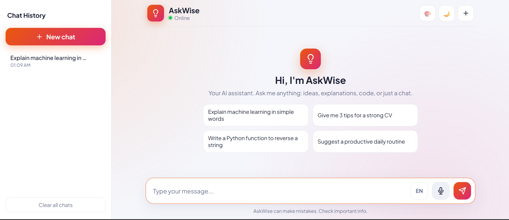
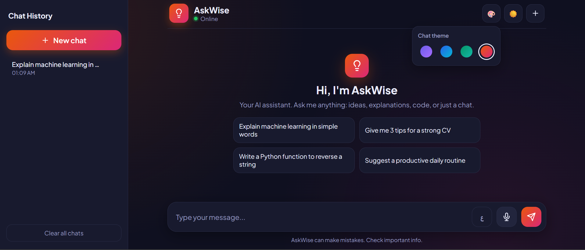
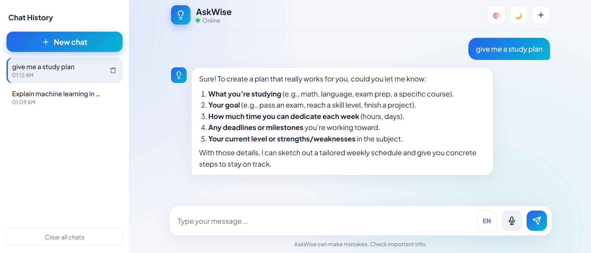
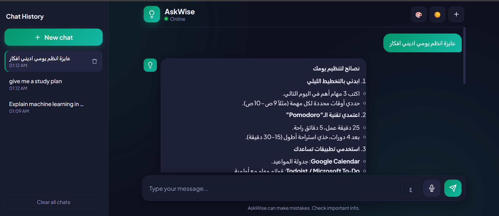
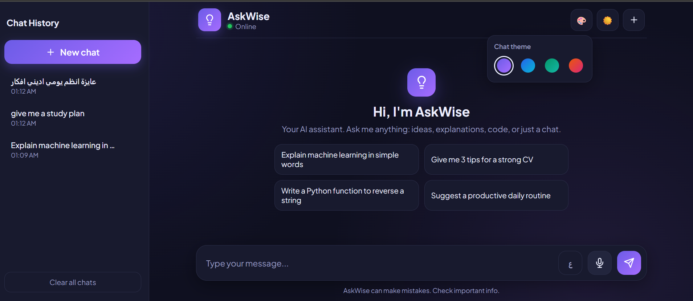
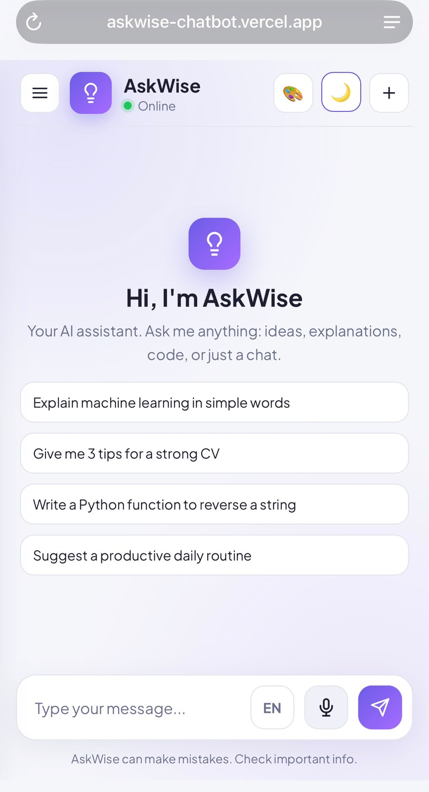

# 💡 AskWise – AI Chatbot Web App

AskWise is an AI chatbot web application where users can chat with an AI assistant through a clean, modern interface. It is built with a Python Flask backend and powered by the Groq API, with voice chat, chat history, and multiple themes.

🔗 **Live Demo:** [askwise-chatbot.vercel.app](https://askwise-chatbot.vercel.app/)

## ✨ Features

**Core**
- Clean, modern chat interface with a welcome screen and quick suggestions
- Real-time AI responses using the Groq API
- Typing animation while the bot is replying
- Remembers the conversation for follow-up questions
- Fully responsive (desktop, tablet, and mobile)

**Chat history**
- Sidebar with saved chats (stored in the browser)
- Open, continue, or delete old chats, or clear them all

**Bonus features**
- 🌙 **Dark mode** – remembers your choice
- 🎨 **Multiple themes** – Violet, Ocean, Emerald, and Sunset
- 🎤 **Voice chatbot** – speak your message (English or Arabic) and listen to replies
- 🧠 **AI response improvement** – custom system prompt, replies in the user's language (Arabic or English) with right-to-left support, formatted answers, and a copy button

## 🛠️ Tech Stack

| Part | Technology |
|---|---|
| Backend | Python, Flask |
| AI | Groq API (GPT-OSS 20B) |
| Frontend | HTML, CSS, JavaScript |
| Voice | Web Speech API |
| Deployment | Vercel |

## 📸 Screenshots

| Light Mode | Dark Mode |
|---|---|
|  |  |

| English Chat | Arabic Chat |
|---|---|
|  |  |

| Chat Themes | Mobile View |
|---|---|
|  |  |

## 🚀 Run Locally

1. Clone the repo:
   ```bash
   git clone https://github.com/meroaymann/askwise-chatbot.git
   cd askwise-chatbot
   ```
2. Create and activate a virtual environment:
   ```bash
   python -m venv venv
   venv\Scripts\activate
   ```
3. Install the requirements:
   ```bash
   pip install -r requirements.txt
   ```
4. Create a `.env` file and add your Groq API key:
   ```
   GROQ_API_KEY=your_api_key_here
   GROQ_MODEL=openai/gpt-oss-20b
   ```
5. Run the app:
   ```bash
   python app.py
   ```
6. Open `http://127.0.0.1:5000` in your browser.

## 📁 Project Structure

```
askwise-chatbot/
├── app.py                 # Flask backend + Groq API
├── requirements.txt
├── templates/
│   └── index.html         # Chat page
├── public/static/
│   ├── css/style.css      # Styling, dark mode, themes
│   └── js/script.js       # Chat logic, history, voice, themes
└── screenshots/
```

## 👩‍💻 Author

**Amira Ayman** – Built as part of the Python Programming internship at **Sqrock IT Solutions**.